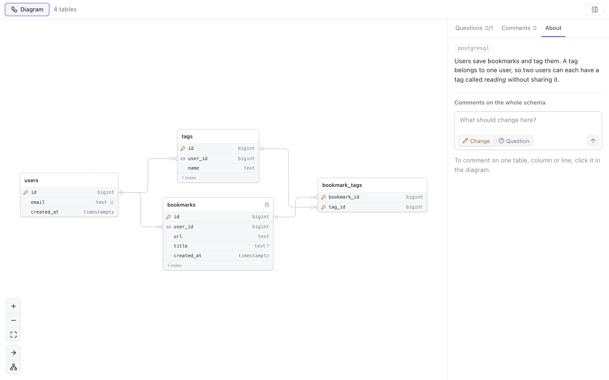

# db-schema

A database schema, or a change to one, that an agent designed. The person
sees it as a diagram of its tables and relationships, comments on a table, a
column, a relationship or the whole schema, and answers the agent's
questions. The agent then applies the schema, or sends a new version.



## Payload

```json
{
  "summary": "Markdown: what the schema is for and its main choices",
  "dialect": "postgresql",
  "tables": [
    { "name": "bookmarks",
      "note": "Markdown: why it is designed this way",
      "change": "added",
      "columns": [
        { "name": "id", "type": "bigint", "primary_key": true },
        { "name": "user_id", "type": "bigint" },
        { "name": "title", "type": "text", "nullable": true },
        { "name": "email", "type": "citext", "change": "changed", "was": { "type": "text" } }
      ],
      "indexes": [{ "name": "bookmarks_user_url", "columns": ["user_id", "url"], "unique": true }] }
  ],
  "relationships": [
    { "id": "bookmarks_user_id_fkey",
      "from": { "table": "bookmarks", "columns": ["user_id"] },
      "to": { "table": "users", "columns": ["id"] },
      "cardinality": "many-to-one", "on_delete": "cascade" }
  ],
  "questions": [
    { "id": "q1", "text": "Should saving the same URL twice update the bookmark?",
      "about": { "table": "bookmarks" },
      "options": ["Update it", "Refuse it"], "proposal": "Update it" }
  ],
  "sql": "the DDL or the migration, shown beside the diagram"
}
```

Columns are NOT NULL unless they are marked `nullable`. A change to an
existing schema marks each table, column, index or relationship as `added`,
`removed` or `changed`, and `was` holds the values a change replaces. Every
question carries a `proposal`, which is what the agent does if the person
leaves it unanswered. A new version, sent with `--revises`, gives the agent's
reply to each of the last round's comments in `replies`, and the view shows
each reply under its comment.

## What the person does

The diagram draws each table as a card with a row per column, and each
relationship as a line between the rows, in crow's foot notation. Added parts
are green, removed parts are red and struck through, and changed parts are
amber, with the old value struck through. The controls at the bottom left
zoom, fit the diagram, switch its direction between left to right and top to
bottom, and choose one of dagre's three layouts. The direction and the
layout are also in the plugin's settings.

A click on a table, a column or a line selects it. The side panel then shows
the part's details, the agent's questions about it, and a box for a comment,
which is a change or a question. The About tab holds the agent's summary and
the comments on the whole schema. The Questions tab lists the agent's
questions, each with its options and a field for an answer.

The verdict follows from the comments. Without change comments, the
hand-over approves. With them, it asks for a new version, unless the person
ticks *Apply my changes without another review*. When questions are left
unanswered, the first hand-over asks for confirmation in the app's
confirmation bar.

Keys: `n` and `p` select the next and previous table, `c` and `q` start a
change or a question on the selected part or on the whole schema, and `f`
fits the diagram. In a comment box, `alt+c` and `alt+q` switch the kind, and
`cmd+enter` (`ctrl+enter` on Linux) adds or saves the comment.

## Decision

```json
{
  "verdict": "revise",
  "comments": [
    { "id": "c1", "target": { "table": "memberships", "column": "role" },
      "kind": "change", "text": "Use an enum." },
    { "id": "c2", "target": { "relationship": "projects_workspace_id_fkey" },
      "kind": "question", "text": "Why restrict rather than cascade?" },
    { "id": "c3", "kind": "change", "text": "Add updated_at to every new table." }
  ],
  "answers": [{ "id": "q1", "choice": "enum type" }],
  "unanswered": ["q2"]
}
```

On `approve`, the agent answers the person's questions and applies the
schema with the changes the comments ask for. On `revise`, it makes the
changes, answers the questions and sends the new version with `--revises`.
A comment without a `target` is about the whole schema. For each question in
`unanswered`, the agent keeps its proposal.

## Building

The view is written in React in `src/`, and Vite builds it into `view/`. It
draws the diagram with [React Flow](https://reactflow.dev) and lays it out
with [dagre](https://github.com/dagrejs/dagre).

```sh
npm ci
npm run build    # writes view/
npm run watch    # rebuilds view/ on every change
```

The tests in `tests/` run from the repository's root with `pnpm test`, after
the build.
